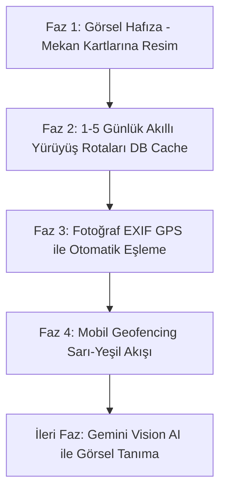

# TatildeBugün - Ürün ve Geliştirme Yol Haritası (RoadMap.md)

Bu doküman, TatildeBugün platformunun kullanıcı deneyimini, akıllı seyahat takip yeteneklerini ve arayüz zenginliğini artıracak stratejik özelliklerin yol haritasını, alt maddelerini ve fazlamasını içerir.

---

## 📌 Temel İlkeler ve Yaklaşım
1. **Mobil-First & Sıfır Yatay Kaydırma (Kural 13):** Tüm yeni arayüzler ve etkileşimler mobilde kusursuz dikey akışta çalışır.
2. **Kullanıcıyı Yormayan (Non-Intrusive) UX:** Kullanıcı seyahatin tadını çıkarırken ekrana sürekli bildirim fırlatılmaz; tespitler arka planda toplanıp sonradan incelenebilir.
3. **Sıfır Veri ve Gizlilik Önceliği:** Fotoğrafların içeriği gerekmedikçe sunucuya yüklenmez, cihaz içinde yerel olarak çözümlenir.

---

## 🗺️ Yol Haritası Fazları

---

## 1. Mekan Kartlarına Küçük Resim (Thumbnail) Entegrasyonu
> **Öncelik:** Yüksek  
> **Kapsam:** Web & Mobil  
> **Maliyet:** 0 TL (Ücretsiz Wikimedia Commons)  
> **Durum:** ✅ **Tamamlandı** (Canlıda Aktif & Roma/Bağdat tohumlandı)

Yabancı şehirlerdeki mekan adları hatırlanması zor olduğundan, her mekan kartına fotoğraf eklenerek anında görsel çağrışım sağlanır.

### Alt Maddeler:
- [x] **1.1. Wikipedia / Wikimedia API Entegrasyonu:**
  - Şehir mekanları çekilirken `fetchWikipediaImage` motoru ile Wikimedia Commons API üzerinden telifsiz, yüksek çözünürlüklü kapak görseli çekildi ([lib/wiki-image.ts](file:///Users/erhanayyildiz/Desktop/Work/TatildeBugun/lib/wiki-image.ts)).
- [x] **1.2. Veritabanı Şeması Desteği:**
  - `places_of_interest` tablosuna `imageUrl` alanı işlendi ve mevcut Roma (40 mekan) ile Bağdat (15 mekan) görsellerle zenginleştirildi.
- [x] **1.3. Mobil-First Kart Tasarımı:**
  - [components/places/city-places-accordion.tsx](file:///Users/erhanayyildiz/Desktop/Work/TatildeBugun/components/places/city-places-accordion.tsx) içerisindeki mekan kartlarının soluna 56x56 / 64x64 boyutlarında şık, yuvarlatılmış köşeli görsel yerleşimi yapıldı.
- [x] **1.4. Görsel Büyütme (Lightbox/Modal):**
  - Kullanıcı küçük resme tıkladığında mekanı tam boyutta net görebileceği Lightbox modalı eklendi.

---

## 2. Şehir Bazlı 1-5 Günlük Akıllı Yürüyüş Rotaları (DB-First Caching)
> **Öncelik:** Yüksek  
> **Kapsam:** Web & Mobil  
> **Maliyet:** Sıfıra Yakın (Şehir başına 1 kez Gemini Flash, sonrası %100 Ücretsiz DB)  
> **Durum:** ✅ **Tamamlandı** (Roma 5 gün, Bağdat 2 gün DB'ye işlendi)

Turistin bir şehirdeki gün sayısına göre (1-5 gün) zikzak çizmeden, mantıklı adım ve yorulma temposuyla yürüyebileceği hazır günlük gezi planları sunulması.

### Alt Maddeler:
- [x] **2.1. Maliyet Bariyeri & Veritabanı Öncelikli Motor:**
  - Standart üyelerin keyfi/serbest AI tetiklemesi engellendi ([lib/actions/itineraries.ts](file:///Users/erhanayyildiz/Desktop/Work/TatildeBugun/lib/actions/itineraries.ts)).
  - Şehir seçildiğinde rota veritabanında (`city_itineraries`) aranır; varsa doğrudan DB'den çekilir (0 TL maliyet).
  - Yoksa o şehirdeki mekanlarımız Gemini 2.0 Flash'a tek seferlik iletilir, 1-5 günlük optimize rotalar üretilip DB'ye kalıcı yazılır.
- [x] **2.2. Algoritmik Kümeleme ve Yürüyüş Temposu:**
  - Her gün için coğrafi kümeleme (Roma: Gün 1 Antik Vadi, Gün 2 Rönesans & Trastevere, Gün 3 Vatikan & Gianicolo, Gün 4 Kuzey & Parklar, Gün 5 Gizli Roma).
  - Günlük 20.000 - 30.000 adıma kadar mantıklı yürüyüş sınırları, yorulma ipuçları ve süre metrikleri.
- [x] **2.3. Tatildeyim Arayüz (UI/UX) Kurgusu:**
  - [components/places/city-itineraries-view.tsx](file:///Users/erhanayyildiz/Desktop/Work/TatildeBugun/components/places/city-itineraries-view.tsx): `[1. Gün]`, `[2. Gün]`, `[3. Gün]`, `[4. Gün]`, `[5. Gün]` sekmeleri.
  - Adım sayısı, toplam km ve tahmini gezi süresi metrik çubuğu.
  - 1'den başlayan dikey zaman çizgili sıralı durak akışı, görseller ve yürüyüş ipuçları.
- [x] **2.4. Durak Check-in Entegrasyonu:**
  - Durak numarasına veya "Tik At" butonuna tıklandığında mekan anında ziyaret edildi (yeşil) durumuna geçer; seyahat rehberiyle tam senkron çalışır.

---

## 3. Fotoğraf Tabanlı Mekan Eşleme ve Keşif (EXIF GPS)
> **Öncelik:** Yüksek  
> **Kapsam:** Web & Mobil  
> **Maliyet:** 0 TL (İstemci Tarafı Çalışır)  
> **Durum:** ✅ **Tamamlandı** (Canlıda Aktif)

Kullanıcının seyahat sırasında telefon kamerasıyla çektiği fotoğrafların konum meta verilerini kullanarak günün rotasını tek tıkla çıkarması.

### Alt Maddeler:
- [x] **3.1. İstemci Tarafında (Client-Side) EXIF GPS Okuma:**
  - Fotoğrafları sunucuya yüklemeden, tarayıcı/cihaz içinde sadece dosya başlığını (`exifr`) okuyan mikro motor ([lib/photo-matcher.ts](file:///Users/erhanayyildiz/Desktop/Work/TatildeBugun/lib/photo-matcher.ts)) geliştirildi (0 MB kota).
- [x] **3.2. "Günün Fotoğraflarından Mekanları Bul" Sihirbazı:**
  - [components/places/photo-match-modal.tsx](file:///Users/erhanayyildiz/Desktop/Work/TatildeBugun/components/places/photo-match-modal.tsx): Fotoğraf seçimi, anlık koordinat analizi ve 400m mesafe eşiğiyle Haversine formülü eşleştirmesi tamamlandı.
- [x] **3.3. Eşleşme Onayı ve Ziyaret Kaydı:**
  - Tespit edilen mekanlar çekim saati ve mesafe rozetleriyle listelenir; kullanıcı tek tıkla toplu olarak onaylayıp ziyaret listesine ekler ([batchRecordPlaceVisits](file:///Users/erhanayyildiz/Desktop/Work/TatildeBugun/lib/actions/places.ts)).
- [ ] **3.4. (İleri Faz - Ertelendi) Gemini Vision AI Görsel Mekan Tanıma:**
  - Konum izni kapalı çekilen fotoğraflarda tarihi yapıyı görselden tanıma motoru (*İleriki aşamalara bırakılmıştır*).

---

## 4. Düşük Pil Tüketimli Geofencing ve "Sarı ➔ Yeşil" UX Kurgusu
> **Öncelik:** Orta (Mobil Uygulama Aşaması)  
> **Kapsam:** Mobil Uygulama (Capacitor / iOS / Android)  
> **Pil Tüketimi:** Düşük (%3 - %5 / Gün)

Kullanıcı yabancı şehirde dolaşırken arkada çalışan geofencing sistemiyle mekanların tespit edilmesi ve rahatsız etmeden kullanıcı kontrolüne sunulması.

### Alt Maddeler:
- [ ] **4.1. Donanımsal Geofencing API Entegrasyonu:**
  - Cihazın sürekli GPS çalıştırmasını engelleyen, baz istasyonu ve Wi-Fi sinyalleriyle çalışan sanal dairesel bölge (çember) takibinin kurulması.
- [ ] **4.2. Asenkron "Sarı (Öneri)" Ziyaret Durumu:**
  - Gezinirken kullanıcıyı anlık pencerelerle bölmek yerine mekanın durumunun arka planda sessizce **"Sarı"** yapılması.
- [ ] **4.3. Toplu Onay ve Günlük Özeti Kartı:**
  - Kullanıcı seyahat günlüğünü açtığında tepede beliren şık özet kartı (*"📍 GPS 4 mekana uğradığınızı tespit etti. Tümünü Onayla"*).
- [ ] **4.4. Anket & Puanlama Entegrasyonu:**
  - Onaylanan mekanların otomatik olarak kullanıcının "Gittim (Yeşil)" listesine katılması.

---

## 📊 İlerleme ve Faz Durum Tablosu

| Madde No | Özellik Adı | Hedef Faz | Durum | Tahmini Efor |
| :--- | :--- | :--- | :--- | :--- |
| **Madde 1** | Mekan Kartlarına Küçük Resim (Thumbnail) | **Faz 1 (İlk Adım)** | ✅ **Tamamlandı** (Canlıda Aktif) | 2-3 Saat |
| **Madde 2** | Şehir Bazlı 1-5 Günlük Akıllı Yürüyüş Rotaları | **Faz 2** | ✅ **Tamamlandı** (Canlıda Aktif) | 4-5 Saat |
| **Madde 3** | Fotoğraf EXIF GPS ile Otomatik Eşleme | **Faz 3** | ✅ **Tamamlandı** (Canlıda Aktif) | 1 Gün |
| **Madde 4** | Geofencing ve "Sarı ➔ Yeşil" UX Kurgusu | **Faz 4 (Mobil)** | 📝 Analiz Edildi / Sırada | 2 Gün |
| **İleri Faz**| Gemini Vision AI ile Görsel Tanıma | **İleri Faz** | ⏸️ Ertelendi | - |

---
